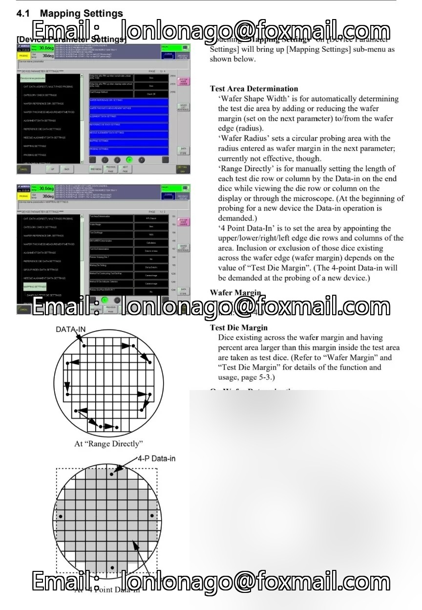
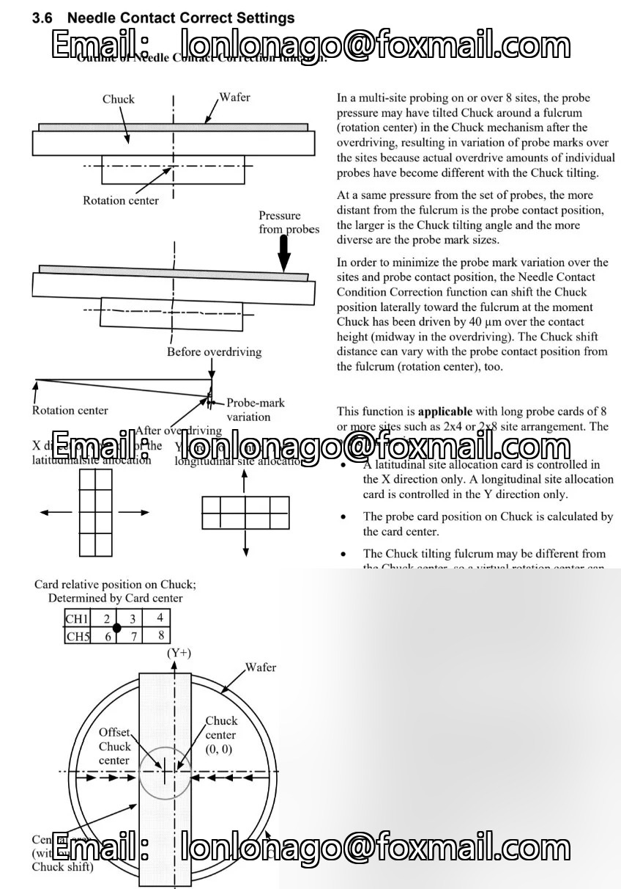
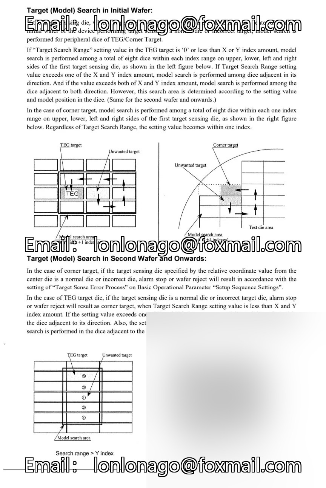
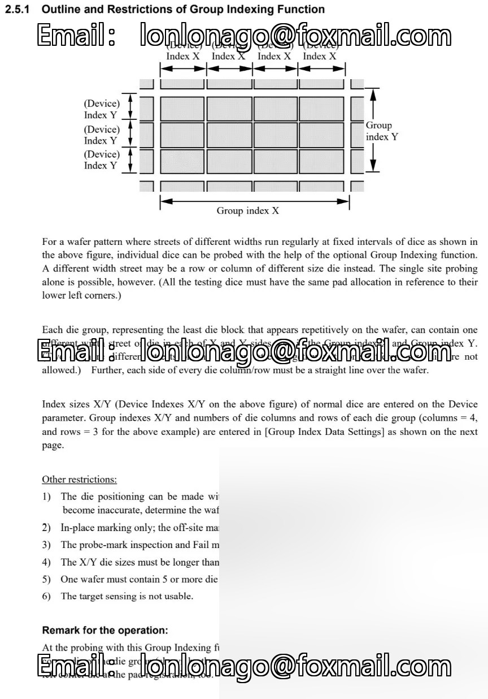
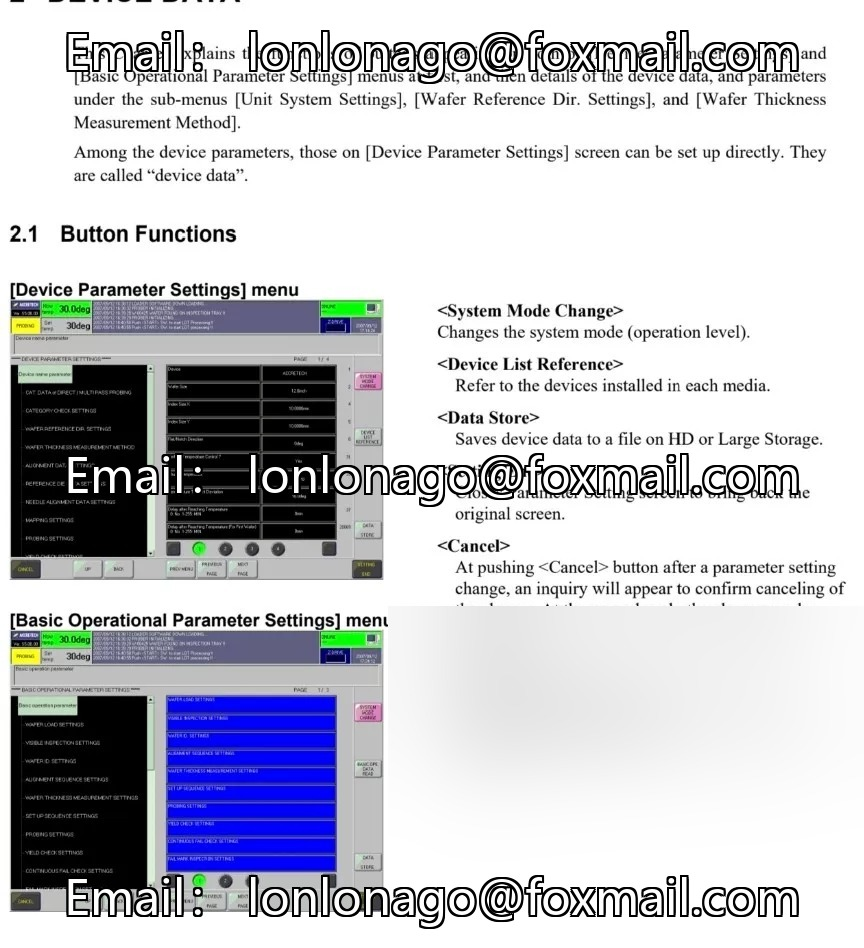

# Japanese Tokyo Precision AP3000 / AP3000e wafer probe station user

## Body

The Japanese Tokyo Precision AP3000 / AP3000e wafer probe station user manual PDF, 160-page , covering equipment parameter settings, operation methods, and functional descriptions, suitable for users of the AP3000/AP3000e series for reference.
This equipment mainly serves the semiconductor integrated circuit (IC) industry, with specific application stages including:

Foundry (Foundry): To conduct comprehensive electrical performance screening of every wafer produced.

FABless chip design company: after tape-out, test the first batch of wafers to verify if the design meets the standards.

Power devices and discrete devices: testing the performance of power chips such as diodes, MOSFET, IGBT, etc.

Light electrical components: cooperated with corresponding testing instruments to test LED, laser diodes, etc.

Research and failure analysis: conducting microscopic electrical property research on new semiconductor materials in the laboratory environment.
FT7

The user handbook PDF has 160 pages covering device parameter settings, operation methods and functional descriptions, and explains the device's application in semiconductor integrated circuits (IC) and its specific usage areas.

<!-- AI_ENRICHED -->

## Images

## Payment

Here is a pay link on Stripe ( https://buy.stripe.com/3cs8yP7sY87d0vu9AB ). Please contact me lonlonago@foxmail.com after funding $89, and I will send you a complete data files , thank you!

